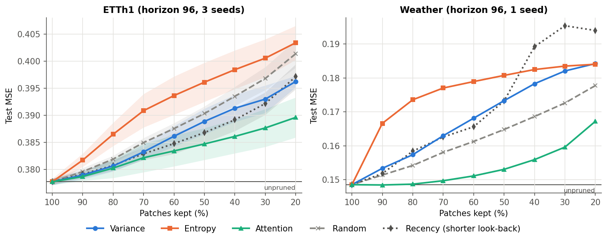
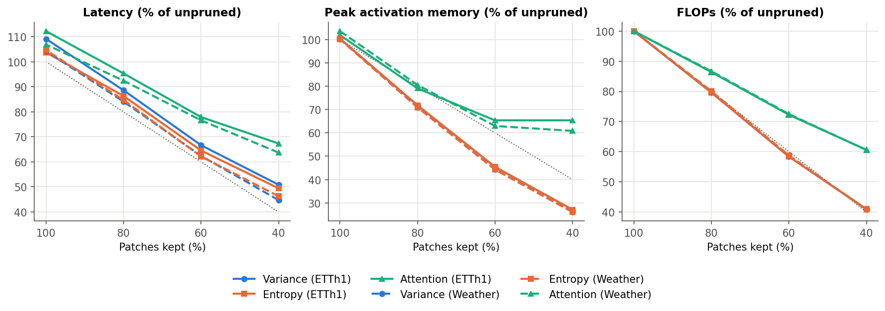
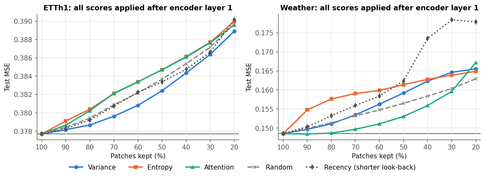
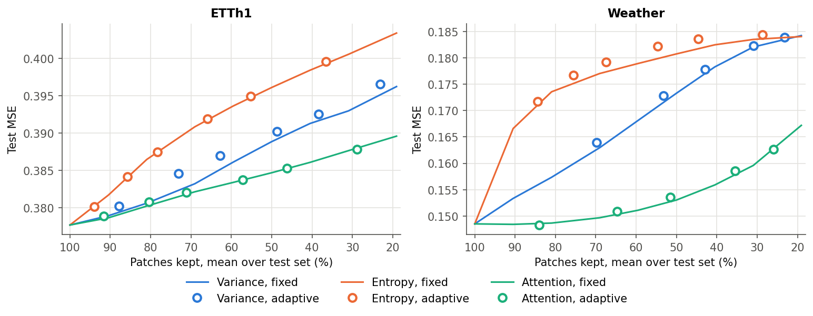
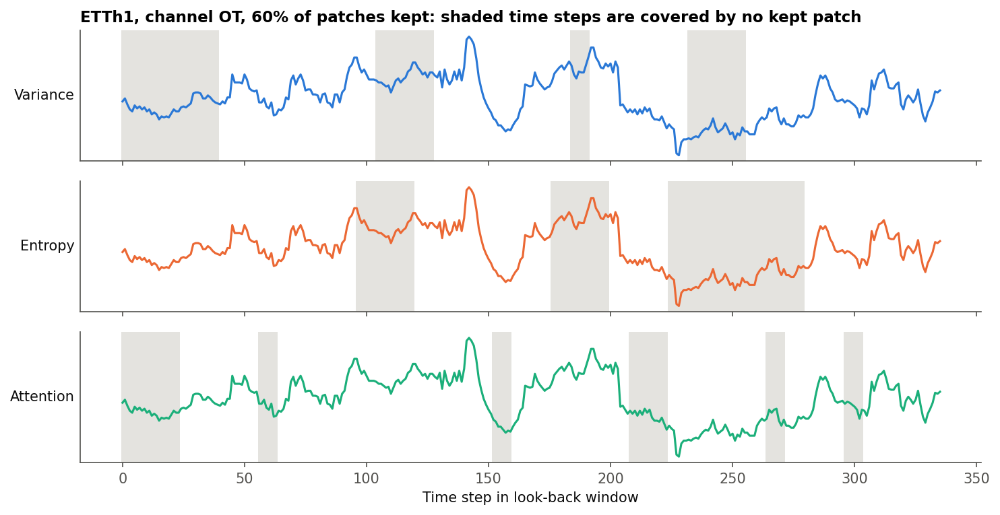

# Patch Pruning for PatchTST

Inference-time token pruning for patch-based time-series Transformers: which patches can a trained
PatchTST skip, and what does it cost in forecasting accuracy for the speed and memory it saves?

## Question

A patch-based forecaster such as PatchTST turns a look-back window into a sequence of patch tokens
and spends most of its compute on self-attention over those tokens. Many patches look redundant: flat
stretches, smooth trends, repeated cycles. **If we drop the patches that carry little information at
inference time, without retraining, how much accuracy is lost, and how much time and memory is saved?**
And does a "low-information" score actually find the patches the model does not need?

## Method

**Model.** PatchTST (Nie et al., ICLR 2023), re-implemented in [patchprune/model.py](patchprune/model.py):
RevIN, channel independence, patches of length 16 with stride 8 (42 patches for a 336-step look-back),
a 3-layer post-norm Transformer encoder with BatchNorm and residual attention, and a flatten-linear
head. Each model is trained once in the standard way, with no pruning during training. The reproduced
baselines match the published numbers (horizon 96):

| Dataset | Model | Test MSE / MAE (this repo) | PatchTST/42 (paper) |
|---|---|---|---|
| ETTh1 | d_model 16, 82k parameters, 3 seeds | 0.378 ± 0.001 / 0.400 ± 0.001 | 0.375 / 0.399 |
| Weather | d_model 64, 362k parameters, 1 seed | 0.149 / 0.198 | 0.152 / 0.199 |

**Pruning.** At inference, each series' patches are scored, the top-scoring fraction is kept, and the
remaining encoder layers run only on the kept tokens, so attention and feed-forward cost shrink with
the number of patches kept ([patchprune/pruning.py](patchprune/pruning.py)). Three scores, plus two baselines:

| Score | Definition | Pruning point |
|---|---|---|
| **Variance** | variance of the instance-normalised patch; flat patches score low | input |
| **Entropy** | mean surprisal −log p(x<sub>t+1</sub> \| x<sub>t</sub>) under a first-order Markov model over 16 quantile bins, fitted on the training split; a lightweight stand-in for EntroPE's learned entropy model | input |
| **Attention** | attention each patch receives in encoder layer 1, averaged over heads and queries (EViT-style) | after layer 1 |
| Random | uniform random scores (baseline) | input |
| Recency | keep the most recent patches, i.e. a shorter look-back window (baseline) | input |

- **Keep levels:** 100, 90, …, 20% of patches; the requested 100/80/60/40% are reported in the tables.
- **Adaptive threshold:** per input, keep the smallest set of patches holding a fraction *p* of
  the (min-shifted) score mass, for *p* ∈ {0.5, 0.7, 0.8, 0.9, 0.95, 0.99}.
- **Dropped patches** bypass the remaining layers and are written back in place before the head (the
  flatten head expects all 42 slots). This was chosen on the **validation** split over replacing them
  with zeros or with the mean of kept tokens: mean validation MSE was 0.718 / 0.868 / 0.918 on ETTh1
  and 0.418 / 0.485 / 0.506 on Weather for bypass / zero / mean.
- **Ablation:** because attention needs one unpruned layer, every score is also evaluated after layer 1
  to separate *what* is pruned from *where* it is pruned.

**Measurements.** Test MSE/MAE on the standardised scale (standard splits: ETTh1 12/4/4 months,
Weather 70/10/20%), averaged over 3 training seeds for ETTh1. Latency is the median of 50 forward
passes on a fixed batch of 32 windows (224 series for ETTh1, 672 for Weather), including scoring, on an
Apple M1 CPU with 4 threads. Peak activation memory is measured by tracking live tensor storage during
the forward pass ([patchprune/profiling.py](patchprune/profiling.py)), and FLOPs with PyTorch's
`FlopCounterMode`.

## Results



Test MSE / MAE at the requested keep levels (ETTh1: mean ± std of MSE over 3 seeds):

| ETTh1 | 100% | 80% | 60% | 40% |
|---|---|---|---|---|
| Variance | 0.378 / 0.400 | 0.381 ± 0.001 / 0.403 | 0.386 ± 0.002 / 0.408 | 0.391 ± 0.003 / 0.413 |
| Entropy | 0.378 / 0.400 | 0.386 ± 0.002 / 0.407 | 0.394 ± 0.004 / 0.413 | 0.398 ± 0.004 / 0.416 |
| Attention | 0.378 / 0.400 | **0.380 ± 0.002 / 0.402** | **0.383 ± 0.003 / 0.404** | **0.386 ± 0.003 / 0.405** |
| Random | 0.378 / 0.400 | 0.382 ± 0.001 / 0.404 | 0.388 ± 0.001 / 0.408 | 0.393 ± 0.002 / 0.413 |
| Recency | 0.378 / 0.400 | 0.381 ± 0.001 / 0.403 | 0.385 ± 0.002 / 0.407 | 0.389 ± 0.002 / 0.411 |

| Weather | 100% | 80% | 60% | 40% |
|---|---|---|---|---|
| Variance | 0.149 / 0.198 | 0.157 / 0.211 | 0.168 / 0.225 | 0.178 / 0.235 |
| Entropy | 0.149 / 0.198 | 0.174 / 0.226 | 0.179 / 0.234 | 0.182 / 0.239 |
| Attention | 0.149 / 0.198 | **0.149 / 0.199** | **0.151 / 0.203** | **0.156 / 0.212** |
| Random | 0.149 / 0.198 | 0.154 / 0.206 | 0.161 / 0.214 | 0.169 / 0.223 |
| Recency | 0.149 / 0.198 | 0.158 / 0.209 | 0.166 / 0.217 | 0.189 / 0.240 |

### Inference cost



Cost relative to the unpruned model (latency / peak memory / FLOPs). Variance, entropy, random and
recency prune at the input and cost the same; attention must run layer 1 on every patch first.

| Kept | Input pruning, ETTh1 | Input pruning, Weather | Attention, ETTh1 | Attention, Weather |
|---|---|---|---|---|
| 80% | 0.89 / 0.72 / 0.80 | 0.84 / 0.71 / 0.80 | 0.95 / 0.79 / 0.86 | 0.92 / 0.81 / 0.87 |
| 60% | 0.67 / 0.45 / 0.58 | 0.62 / 0.44 / 0.59 | 0.78 / 0.65 / 0.72 | 0.77 / 0.63 / 0.72 |
| 40% | 0.51 / 0.27 / 0.41 | 0.45 / 0.26 / 0.41 | 0.67 / 0.65 / 0.61 | 0.64 / 0.61 / 0.61 |

Unpruned: 32.7 ms, 36.5 MiB, 0.40 GFLOPs per batch (ETTh1); 187.7 ms, 202.4 MiB, 6.86 GFLOPs (Weather).
Absolute numbers for every method are in [results/summary.md](results/summary.md).

### Is it the score or the pruning point?



Applied at the same point as attention, the input-level scores improve sharply. On ETTh1 all five land within
about one seed-standard-deviation of each other (variance is nominally best). On Weather, attention
keeps a smaller edge (+5.0% MSE at 40% kept, against +6.6% for random and +9.3% for variance).

### Fixed vs. adaptive keep ratio



At the same average number of patches, the per-input adaptive threshold matches or slightly trails
the fixed keep ratio for all three scores.



## Findings

A trained PatchTST tolerates aggressive patch pruning when the decision is made after one encoder
layer: attention-based pruning keeps 40% of patches for +2.2% MSE on ETTh1 and +5.0% on Weather
(no loss at 80% on Weather), at 0.64–0.67× latency and 0.61–0.65× peak memory. Scores computed on raw
patches do not identify unneeded patches: variance is no better than random on ETTh1 and worse on
Weather, and entropy (surprisal) is the worst score on both datasets, so low signal-level information
is not the same as low importance to the forecaster. When every score is applied after layer 1, most of
the gap closes and even random selection comes close, which means attention's advantage comes mainly
from *where* it prunes rather than from the score itself. The cheapest regime, input pruning (0.45–0.51×
latency and 0.26–0.27× memory at 40% kept), therefore needs a better score: a learned, forecast-aware
entropy model in the spirit of EntroPE, or training with patch dropout so the model expects missing
patches, are the natural next steps.

## Reproduce

```bash
pip install -r requirements.txt
python scripts/download_data.py
python -m pytest -q tests          # pruning-path unit tests
bash scripts/run_all.sh            # train, evaluate, benchmark, plot
```

Or step by step:

```bash
python scripts/train.py --dataset ETTh1 --seed 2021
python scripts/evaluate_pruning.py --dataset ETTh1 --seeds 2021
python scripts/benchmark_efficiency.py --dataset ETTh1 --seed 2021
python scripts/make_figures.py
```

On an Apple M1 CPU, one ETTh1 model trains in about 30 minutes and the Weather model in about
75 minutes. A free Colab GPU is faster; see [notebooks/colab_quickstart.ipynb](notebooks/colab_quickstart.ipynb).

```
patchprune/
  model.py        PatchTST with a pruning-aware encoder
  pruning.py      patch scores, fixed and adaptive selection
  data.py         datasets and standard splits
  configs.py      per-dataset hyper-parameters
  profiling.py    latency, peak-memory and FLOP measurement
scripts/          train, evaluate, benchmark, plot, run_all.sh
results/          raw CSVs, training logs (JSON) and summary tables
figures/          figures used in this README
tests/            unit tests (pruning at 100% is exact; padded adaptive path = per-series path)
```

## Notes and limitations

- Pruning is training-free. Dropped patches skip the remaining encoder layers but still reach the head
  as their pre-pruning representation; deleting them entirely (zero or mean fill) is much worse with a
  flatten head.
- The Weather model is narrower than the paper's (d_model 64 rather than 128), trains on every 4th window,
  and uses one seed; its numbers carry more uncertainty than ETTh1's.
- Latency is measured on a laptop CPU. Relative savings follow FLOPs and memory closely, but absolute
  speed-ups on a GPU will differ.
- Only horizon 96 is evaluated.

## Related work

Related to EntroPE (Li Xiaoli's group) and my token pruning work (KAIS).

- Y. Nie, N. H. Nguyen, P. Sinthong, J. Kalagnanam. *A Time Series is Worth 64 Words: Long-term
  Forecasting with Transformers.* ICLR 2023.
- S. Abeywickrama, E. Eldele, M. Wu, X. Li, C. Yuen. *EntroPE: Entropy-Guided Dynamic Patch Encoder for
  Time Series Forecasting.* arXiv:2509.26157, 2025.
- Y. Liang, C. Ge, Z. Tong, Y. Song, J. Wang, P. Xie. *Not All Patches are What You Need: Expediting
  Vision Transformers via Token Reorganizations (EViT).* ICLR 2022.

## License

MIT
